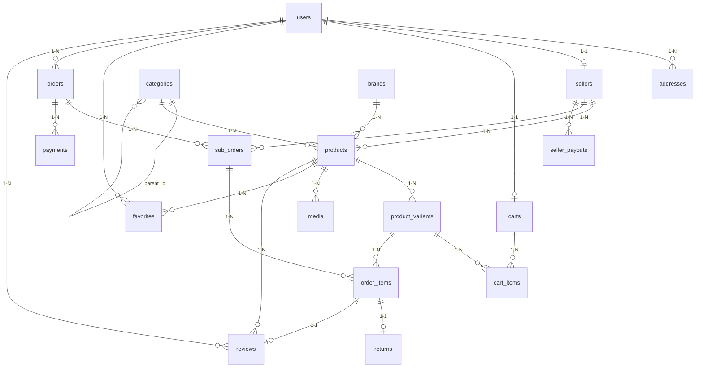

# LaraMart — Çok Satıcılı E-Ticaret Pazaryeri Projesi

**LaraMart**, Laravel 13 ve PHP 8.3+ üzerine inşa edilmiş, Amazon/Hepsiburada iş modelinde çalışan çok satıcılı (multi-vendor) bir e-ticaret pazaryeri platformudur.

---

## 1. Mimari ve Teknik Yığın (Tech Stack)
- **Çatı & Dil:** PHP 8.3+, Laravel 13
- **Veritabanı:** MySQL 8 / SQLite (Geliştirme & Test) — 20 Zorunlu Tablo
- **Önyüz:** Blade + Livewire + Tailwind CSS
- **Yetkilendirme:** `spatie/laravel-permission` + Laravel `Policy` Sınıfları
- **Görsel Yönetimi:** `spatie/laravel-medialibrary`
- **Arama:** Laravel Scout + Eloquent/Fulltext filtreleme
- **Ödeme:** iyzico Sandbox (3D Secure simülasyonu + Idempotency + Pessimistic Locking)
- **API:** Laravel Sanctum (`/api/v1/...`)
- **Test & Kalite:** Pest (53+ Test), Laravel Pint (Allman Style), Larastan

---

## 2. Üç Altın Tasarım Kuralı Uygulaması
1. **Kesin Parasal Veri Tipi (`decimal(10,2)`):** Tüm fiyat, indirim, kargo, komisyon ve hakediş sütunları `decimal(10,2)` olarak tanımlanmıştır (`float` kesinlikle kullanılmamıştır).
2. **Sipariş Anı Veri Kopyalama (Snapshot):** Sipariş oluştuğu anda teslimat adresi `orders.address` (JSON) sütununa, ürün adı ve birim fiyatı ise `order_items.product_name` ve `order_items.price` sütunlarına kopyalanır. Satıcı fiyatı sonradan değiştirse bile geçmiş sipariş bozulmaz.
3. **Eşzamanlı Stok Düşümü (`DB::transaction` + `lockForUpdate()`):** Stoklar `product_variants` tablosunda tutulur. Ödeme onaylandığında `CreateOrderAction` içinde tek bir veritabanı transaction'ı başlatılır ve `lockForUpdate()` ile stok satırları kilitlenerek son 1 stoklu ürünün aynı anda iki kişi tarafından alınması (race condition) engellenir.

---

## 3. Kurulum Adımları

```bash
composer install
cp .env.example .env
php artisan key:generate
php artisan migrate:fresh --seed
npm install && npm run build
php artisan serve
```

Testleri çalıştırmak için:
```bash
php artisan test
```

---

## 4. Demo Hesapları (Şifre: `password`)

| Rol | E-Posta | Şifre | Panel Adresi |
| :--- | :--- | :--- | :--- |
| **Admin** | `admin@laramart.test` | `password` | `/admin` |
| **Satıcı 1 (TeknoMerkez)** | `satici1@laramart.test` | `password` | `/satici` |
| **Satıcı 2 (ModaVizyon)** | `satici2@laramart.test` | `password` | `/satici` |
| **Müşteri** | `musteri@laramart.test` | `password` | `/hesabim` |

---

## 5. Veritabanı ER Diyagramı (20 Zorunlu Tablo)


