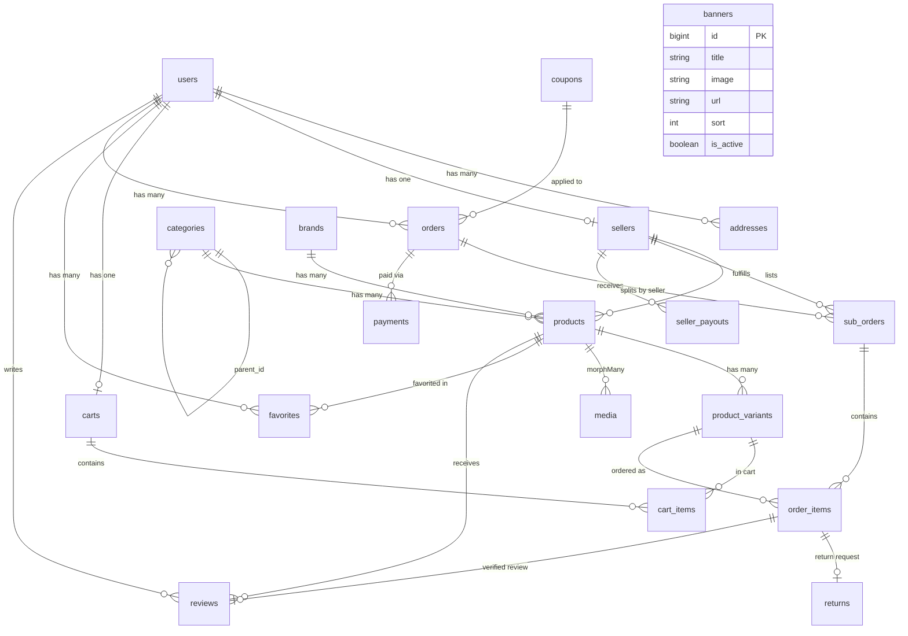

# LaraMart Veritabanı Tasarımı (ER Diyagramı)

Bu doküman, LaraMart çok satıcılı e-ticaret pazaryeri projesinin **20 zorunlu tablosunu**, aralarındaki ilişkileri ve temel veritabanı kurallarını açıklar.

> **dbdiagram.io kullanımı:** Görsel editörde incelemek veya PNG/PDF dışa aktarmak için [er-diagram.dbml](er-diagram.dbml) dosyasının içeriğini https://dbdiagram.io/d adresine yapıştırabilirsiniz.

## Üç Zorunlu Tasarım Kuralı

1. **Parasal Hassasiyet:** Tüm fiyat, indirim, kargo, komisyon ve tutar kolonları `DECIMAL(10,2)` olarak saklanır; asla `FLOAT` kullanılmaz.
2. **Sipariş Anı Kopyası (Snapshot):** Sipariş oluşturulduğu andaki teslimat adresi (`orders.address` JSON), ürün adı (`order_items.product_name`) ve birim fiyat (`order_items.price`) sipariş tablolarına kopyalanır. Satıcı sonradan ürün adını veya fiyatını değiştirse bile eski siparişler etkilenmez.
3. **Stok ve Eşzamanlılık Koruması:** Stok bilgisi `product_variants` tablosunda tutulur ve ödeme onayında tek bir veritabanı transaction'ı içinde `lockForUpdate()` ile düşülür.

## ER Diyagramı (Mermaid)

## 20 Zorunlu Tablo Özeti

| # | Tablo | Amaç | Temel İlişkiler |
| :-: | :--- | :--- | :--- |
| 1 | `users` | Müşteri, satıcı ve admin hesapları | Roller `spatie/laravel-permission` tablolarında |
| 2 | `addresses` | Kullanıcı adres defteri | `users` 1–N |
| 3 | `sellers` | Satıcı mağaza bilgileri, onay durumu, komisyon | `users` 1–1 |
| 4 | `categories` | Sınırsız derinlikli kategori ağacı ve komisyon oranı | Kendi kendine ağaç (`parent_id`) |
| 5 | `brands` | Ürün markaları ve logoları | `products` 1–N |
| 6 | `products` | Satıcıların listelediği ana ürünler | `sellers`, `categories`, `brands` N–1 |
| 7 | `product_variants` | Renk, beden, SKU, fiyat, indirimli fiyat ve stok | `products` 1–N |
| 8 | `media` | Çoklu ürün görselleri ve küçük resimler (MediaLibrary) | `products` 1–N (polimorfik) |
| 9 | `carts` | Üye veya misafir (session) alışveriş sepeti | `users` 1–1 |
| 10 | `cart_items` | Sepetteki ürün varyantları ve adetleri | `carts` 1–N, `product_variants` N–1 |
| 11 | `favorites` | Kullanıcının favori ürünleri | `users` N–N `products` |
| 12 | `coupons` | İndirim kuponları (yüzde/tutar, tarih, limit) | `orders` 1–N |
| 13 | `orders` | Müşterinin tek ödeme yaptığı ana sipariş | `users` 1–N |
| 14 | `sub_orders` | Ana siparişin satıcı başına bölünmüş alt siparişi | `orders` 1–N, `sellers` 1–N |
| 15 | `order_items` | Alt siparişteki ürün kalemleri (ad ve fiyat kopyalı) | `sub_orders` 1–N |
| 16 | `payments` | iyzico ödeme kayıtları ve ham JSON yanıtları | `orders` 1–N |
| 17 | `returns` | Teslim edilen kalemler için 14 günlük iade talepleri | `order_items` 1–1 |
| 18 | `reviews` | Yalnızca satın alanların yazabildiği ürün yorumları | `users`, `products`, `order_items` |
| 19 | `seller_payouts` | Satıcı aylık ciro, komisyon ve net hakediş kayıtları | `sellers` 1–N |
| 20 | `banners` | Ana sayfa kampanya slider görselleri | Bağımsız vitrin tablosu |
